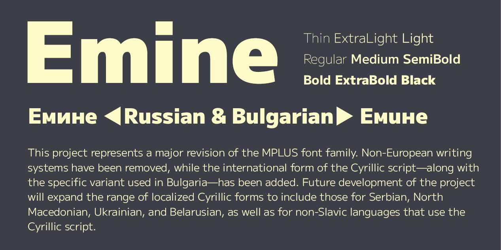

Emine
============

This project represents a major revision of the [MPLUS font](https://github.com/coz-m/MPLUS_FONTS) family. Non-European writing systems have been removed, while the international form of the Cyrillic script—along with the specific variant used in Bulgaria—has been added. Future development of the project will expand the range of localized Cyrillic forms to include those for Serbian, North Macedonian, Ukrainian, and Belarusian, as well as for non-Slavic languages ​​that use the Cyrillic script.  
  
Acknowledgements
----------------

If you make modifications to the project, be sure to add your details below, including <code>your name</code> (N), <code>email</code> (if you have one) (E), <code>web-address</code> (if you have one) (W), <code>twitter handle</code> (if you have one) (T) and <code>description</code> (D).

### Project Manager

+ N: Stefan Peev
+ E: localfonts.eu@gmail.com
+ W: https://localfonts.eu
+ T: https://twitter.com/localfonts
+ D: Project Manager and Designer

License
-------

SIL Open Font License [OFL](documentation/OFL.md)

Changelog
---------

See the [Changelog.md](https://github.com/StefanPeev/Emine/blob/main/Changelog.md).

SIL Open Font License [OFL](documentation/OFL.md)

Examples
--------

See [images](/images/), [Gallery](/images/Gallery.md).

Projects using Emine
----------------------

Have you made something nice with Emine?  
[Please share it in Discussions section](https://github.com/StefanPeev/Emine/discussions/1).  
  
Localfonts projects
-------------------
  
The primarily aim of the project **LOCALFONTS** is to extend Cyrillic in fonts published under licenses which permit modifications and derivative works by adding Cyrillic local forms (Bulgarian, Serbian, Macedonian, Ukrainian etc.).  
The **Localfonts** project consists of the following fonts:

+ [Acari Sans](https://github.com/StefanPeev/acari-sans/tree/local) 
+ [Common Sans](https://github.com/StefanPeev/Common-Sans)  
+ [Common Serif](https://github.com/StefanPeev/Common-Serif)  
+ [Coval](https://github.com/StefanPeev/coval)  
+ [Dinish](https://github.com/StefanPeev/dinish/tree/cyrillic)  
+ [Emine](https://github.com/StefanPeev/Emine)  
+ [Ezerovo](https://github.com/StefanPeev/Ezerovo)  
+ [Gabriela](https://github.com/StefanPeev/Gabriela)  
+ [Grazhdanskiy Shrift](https://github.com/StefanPeev/Grazhdanskiy-Shrift)  
+ [Involve](https://github.com/StefanPeev/Involve)  
+ [Libra Sans](https://github.com/StefanPeev/Libra-Sans)  
+ [Linguistics Pro](https://github.com/StefanPeev/Linguistics-Pro)  
+ [Listopad | Open Sans](https://github.com/StefanPeev/opensans/tree/local)  
+ [Open Sans](https://github.com/StefanPeev/opensans/tree/local)  
+ [Perun](https://github.com/StefanPeev/Perun)  
+ [Pliska](https://github.com/StefanPeev/Pliska)  
+ [Prolog | Libre Moretus](https://github.com/StefanPeev/libre-moretus/tree/prolog)  
+ [Repo](https://github.com/StefanPeev/Repo)  
+ [Scada | Cascade](https://github.com/StefanPeev/Scada-Cascade/tree/local)  
+ [Spritulo](https://github.com/StefanPeev/spritulo)  
+ [Terminalia](https://github.com/StefanPeev/Terminalia)  
+ [Veleka](https://github.com/StefanPeev/Veleka)  
  
Donations
---------

If you apreciate the project, please feel free to support us through [sponsorship button](https://github.com/sponsors/StefanPeev).  
  
